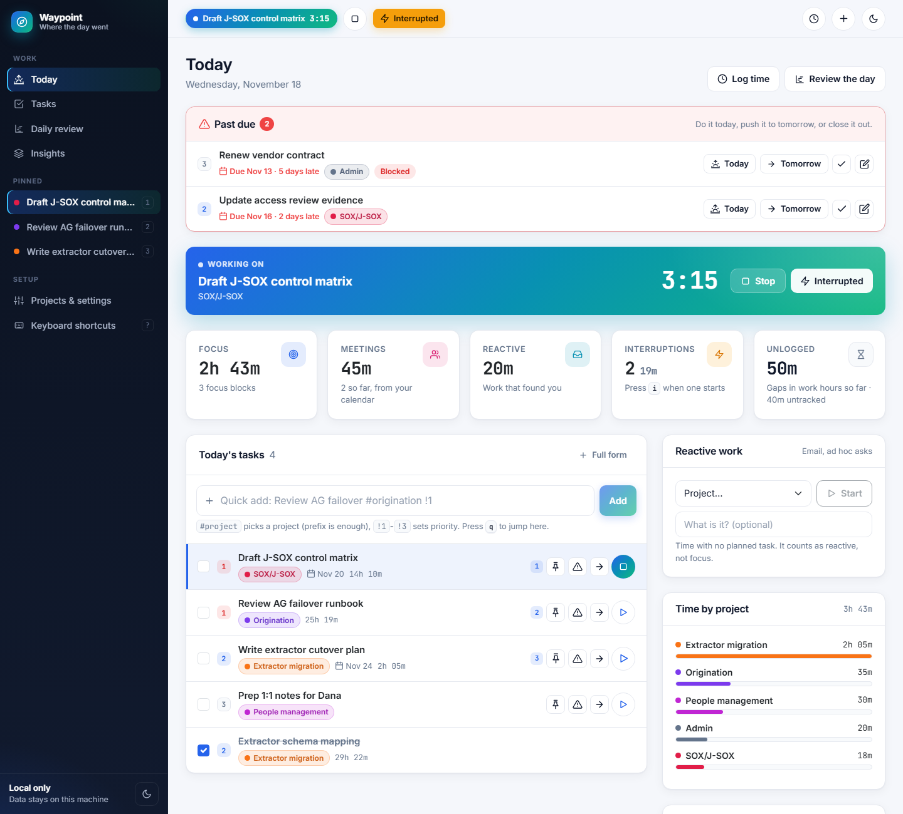
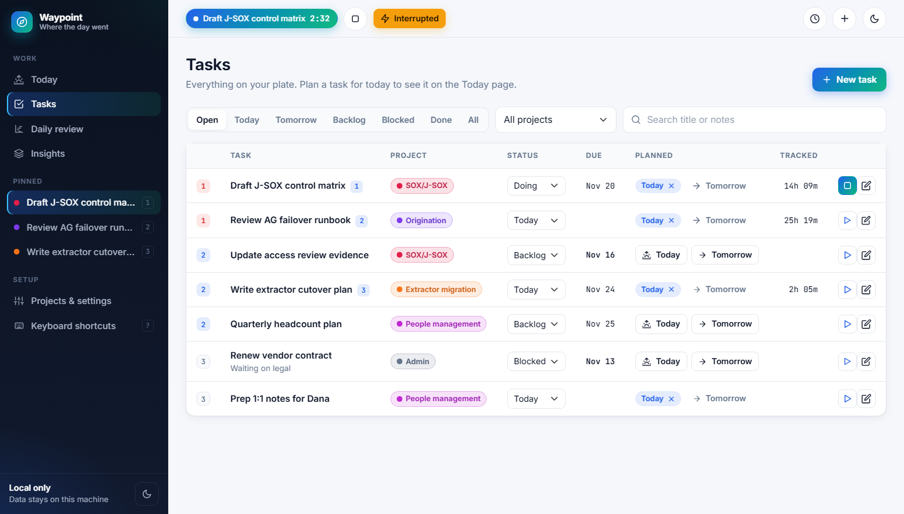
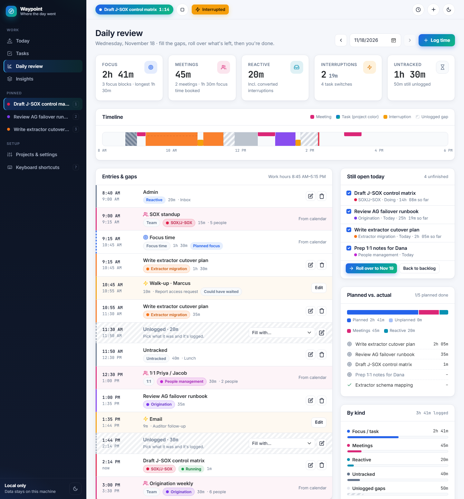
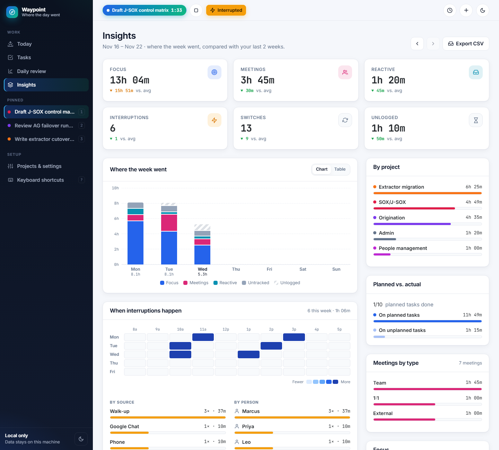
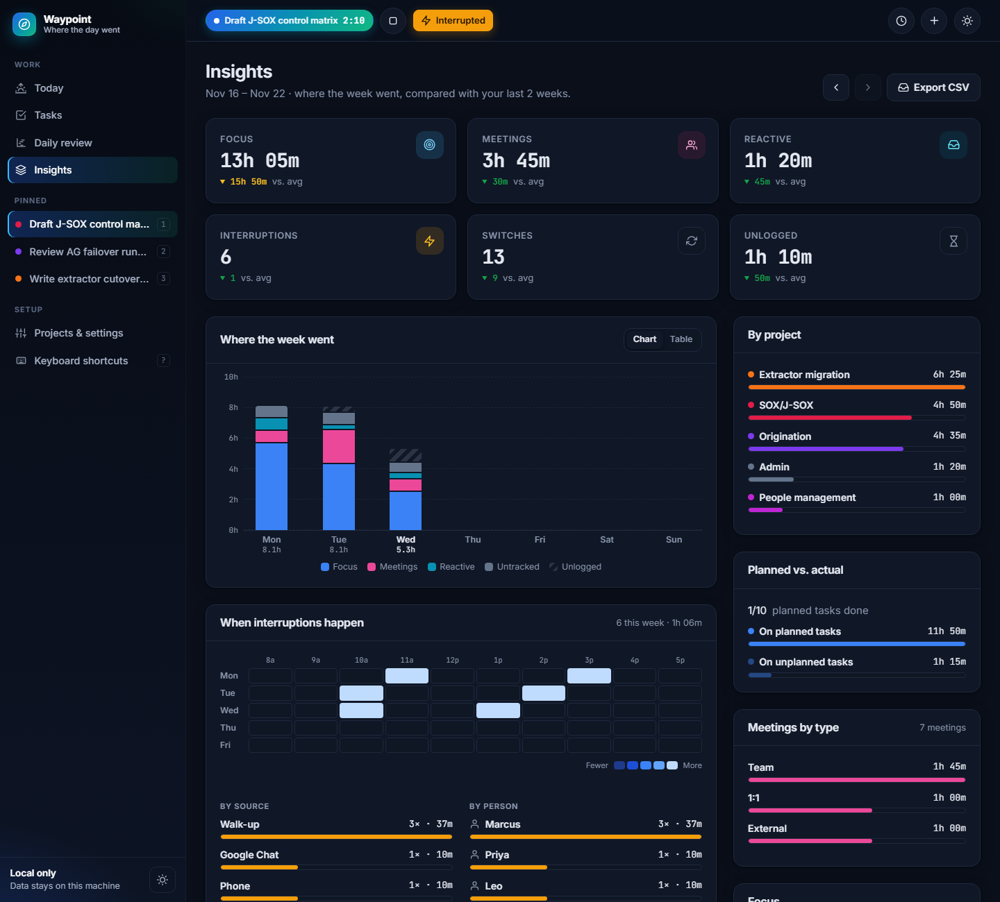
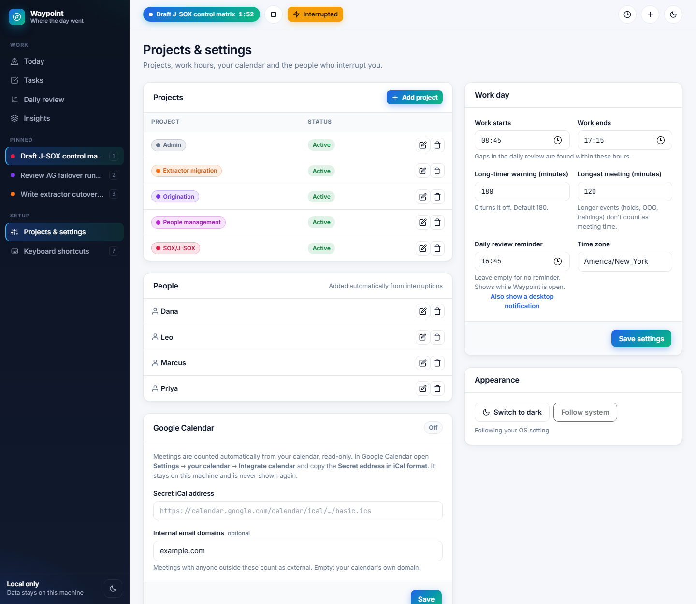

# Waypoint

A personal work tracker for one person on one laptop. It answers **where did my time go?** by project, and how much of it was meetings, focus work, reactive work and interruptions.

Nothing monitors your desktop. Time comes from:

- task timers you start and stop;
- entries you add after the fact;
- your Google Calendar (read-only, optional);
- a one-click **Interrupted** button.

The goal is under five minutes of data entry a day, including the end-of-day review. All data stays on your machine: Waypoint runs in Podman, and every port is bound to `127.0.0.1`.

> The screenshots below use made-up sample data.

## A tour of the app

### Today



Where the day starts.

- **Past due** lists every open task whose due date has passed, oldest first, planned for today or not. Each one has buttons to do it **Today**, push it to **Tomorrow**, mark it done, or edit it to change the due date.
- **The running timer.** One click starts a timer on a task. Only one runs at a time, and starting another stops the current one. The timer is stored on the server, so it keeps running if you close the browser. A warning shows if a timer has run longer than 3 hours (configurable) or past midnight.
- **Interrupted** pauses the timer and opens a short form:
  - source: walk-up, Google Chat, email, phone, meeting overrun or self-distraction;
  - optional person, with autocomplete from past entries;
  - optional note, and whether it could have waited.

  **Back to work** (`b`) resumes the paused task and records how long the interruption took. An interruption can also be saved as a task, with its time attached as reactive work.
- **Today's tasks**, with a **quick add** box: `Review AG failover #origination !1` creates a task in the Origination project with priority 1. On each task you can:
  - start or stop its timer;
  - pin it to a number key (`1`-`5`);
  - mark it blocked;
  - send it back to the backlog;
  - tick it done.
- **Reactive work** starts a timer for email or ad hoc asks with no planned task. It counts as reactive, not focus.
- Tiles for today's focus, meetings, reactive time, interruptions and unlogged time, plus time by project.

### Tasks



Everything on your plate:

- Filter by Open, Today, Tomorrow, Backlog, Blocked, Done or All, by project, or with text search.
- Each task has a title, project, priority (1-3), due date, notes, status (Backlog / Today / Doing / Blocked / Done) and planned date.
- The **Planned** column moves a task in one click:
  - **Today** puts it on today's list;
  - **Tomorrow** plans it for tomorrow, and it appears on the Today page then;
  - **×** unplans it.
- Overdue due dates are highlighted, and each task shows the total time tracked on it.

### Daily review



The end-of-day check, usually a couple of minutes:

- **Timeline** of the day: meetings from your calendar, time entries, interruptions, and **gaps**, which are untracked time within your work hours (08:45-17:30 by default).
- **Fill a gap in one step**: pick a project or "untracked" and it becomes a time entry, or open the full form for a task and note.
- **Warnings that need a click**:
  - interruptions with no source;
  - a timer that ran during a meeting (the meeting wins in the totals);
  - two entries that cover the same time.
- **Still open today**: tick the unfinished tasks and roll them over to the next work day, or send them back to the backlog.
- **Planned vs. actual**: time on the tasks you planned, against unplanned work, meetings and reactive work.
- Totals by kind and by project, the number of **focus blocks** (25+ minutes on one task with no interruption) and **task switches**.

Adding or editing a time entry never double-counts. If a new entry overlaps an existing one, the existing one is trimmed, split around it, or replaced, and a toast says what changed. A running timer that gets split keeps running.

### Insights



The weekly summary:

- **Where the week went**: focus, meetings, reactive, untracked and unlogged time per day. Hover for details, or switch to the table view.
- Each stat tile compares the week with your **average over the previous 4 weeks**. Weeks with no data are skipped, so a new install isn't compared with zeros.
- **When interruptions happen**: a weekday × hour heatmap, plus breakdowns by source and by person, so you can see whose questions could be batched.
- Time **by project**, **meetings by type** (1:1, team, external, recurring, ad hoc), **planned vs. actual** for the week, and the **longest focus block**.
- **Export CSV** of time entries, interruptions, meetings or daily totals, for this week or the last 30 days.

Dark mode, which follows your OS or a saved choice:



### Projects & settings



- **Projects**, each with a color from a fixed palette.
- **People**, added automatically from interruptions. You can rename or delete them here.
- **Work day**:
  - work hours, used for gap detection;
  - the long-timer warning;
  - the longest event that still counts as a meeting (default 120 minutes, so holds, OOO and trainings don't count);
  - a **daily review reminder** time;
  - your time zone.
- **Google Calendar**: paste your calendar's *Secret address in iCal format* (Google Calendar → Settings → your calendar → Integrate calendar). Waypoint syncs it every 15 minutes, and on demand, read-only.
  - Events that don't count as meeting time: all-day, free, declined, and longer than the limit.
  - **Focus Time** events count as planned focus.
  - The address is stored only in the local database and is never shown again.
- **Meeting rules**: "title contains *SOX*" → SOX/J-SOX project. The first matching rule wins, and a new rule also applies to past meetings.

> **Policy (NFR-7):** the calendar feed is the only outbound call Waypoint makes. It reads calendar data from Google, so confirm with InfoSec before turning it on. It only accepts `https://calendar.google.com` addresses.

### Keyboard shortcuts

| Key | Action |
|---|---|
| `s` | Start/stop the timer |
| `1`-`5` | Switch to a pinned task |
| `i` | Interrupted |
| `b` | Back to work |
| `q` | Quick add |
| `n` | New task |
| `l` | Log time |
| `?` | Help |

### Not built yet

Phase 3 is not built: LLM features (natural-language entry, gap-fill suggestions, a weekly narrative and so on) and Google Tasks import. See [deploy/requirements.md](deploy/requirements.md) for the full requirements and [docs/architecture.md](docs/architecture.md) for how the app works.

## Prerequisites

| Tool | Used for |
|---|---|
| [Podman Desktop](https://podman-desktop.io) (Podman + a WSL2 machine, with the compose extension) | Running the pod |
| [.NET 10 SDK](https://dotnet.microsoft.com/download/dotnet/10.0) | API development and tests |
| [Node.js 22 LTS](https://nodejs.org), 22.22.3 or later (npm 10) | Web development and tests (Angular 22 requirement) |
| VS Code (optional) | The repo includes `.vscode/` with recommended extensions, tasks and launch configs |

## Run it in Podman (day-to-day use)

From PowerShell in the repo:

```powershell
cd deploy
./start.ps1 -Build      # first run, or after pulling changes
./start.ps1             # later starts
```

The script:

1. starts the Podman machine if needed,
2. runs `podman compose up -d`,
3. waits for the health check,
4. opens **http://127.0.0.1:8080**.

You can also run the steps by hand:

```powershell
cd deploy
podman compose up -d --build
podman compose ps
podman compose logs -f api
podman compose down          # stop (data is kept in the waypoint-pgdata volume)
```

What runs:

| Container | Port (localhost only) | Purpose |
|---|---|---|
| `waypoint-web` | `127.0.0.1:8080` | nginx serving the Angular PWA and proxying `/api` |
| `waypoint-api` | `127.0.0.1:8081` | ASP.NET Core API. Applies EF Core migrations and seeds defaults at startup |
| `waypoint-db` | `127.0.0.1:5432` | PostgreSQL 17, data in the named volume `waypoint-pgdata` |

To change ports or the DB password, copy `deploy/.env.example` to `deploy/.env`. The default password is fine for a localhost-only database, but you can set your own.

On macOS/Linux, `deploy/start.sh` and `deploy/backup.sh` do the same jobs. They use Podman, or Docker if Podman isn't installed.

### Backups

```powershell
cd deploy
./backup.ps1                 # writes deploy/backups/waypoint-yyyyMMdd-HHmmss.dump, prunes dumps older than 30 days
```

Restore a dump into the running container:

```powershell
podman exec -i waypoint-db pg_restore -U waypoint -d waypoint --clean --if-exists < backups/waypoint-20261117-180000.dump
```

To run it daily, add a Windows Task Scheduler job that runs `pwsh -File <repo>\deploy\backup.ps1`.

## Run it locally for development

Start only the database in Podman, then run the API and the web dev server on the host:

```powershell
podman compose -f deploy/compose.yaml up -d db

# API on http://localhost:5080 (applies migrations on start)
dotnet run --project api/src/Waypoint.Api --launch-profile http

# Web on http://localhost:4200 (proxies /api to :5080, see web/proxy.conf.json)
cd web
npm ci
npm start
```

In VS Code:

- Run the task **db: start (podman)**.
- Then launch **Full stack (API + Web)**, or start **API (.NET)** and **Web (ng serve + Edge)** separately.
- `docs/api.http` has ready-made requests for the REST Client extension.

The API's connection string is `ConnectionStrings:Waypoint` in `api/src/Waypoint.Api/appsettings.json`. It defaults to the containerized DB on `localhost:5432`.

### Tests

```powershell
dotnet test api/Waypoint.slnx           # xUnit: parser, gaps/totals, timer/interruption flows, iCal import, metrics, roll-over, CSV, migration snapshot
cd web; npx ng test --watch=false       # Vitest: time-zone helpers, timeline layout, shell
```

### Database migrations

Migrations are applied automatically when the API starts. To change the model:

```powershell
dotnet tool install --global dotnet-ef   # once
cd api/src/Waypoint.Api
dotnet ef migrations add <Name> --output-dir Data/Migrations
```

> **Note:** the initial migration (`Data/Migrations/20261117170000_InitialCreate*`) was written by hand, because the EF tooling could not be run when Phase 1 was built. The Phase 2 migration was generated with `dotnet ef` against that snapshot with no spurious changes, which confirms the snapshot.
>
> The test `MigrationTests.Model_has_no_pending_changes` checks the snapshot against the model.
>
> If that test fails on a fresh clone with an empty database:
>
> 1. Delete `Data/Migrations`.
> 2. Run `dotnet ef migrations add InitialCreate --output-dir Data/Migrations`.
> 3. Drop the volume with `podman compose down -v`.

## Project structure

```
waypoint/
├─ api/
│  ├─ Waypoint.slnx
│  ├─ Dockerfile
│  ├─ src/Waypoint.Api/
│  │  ├─ Program.cs                 # DI, JSON, error handling, migrate + seed at startup
│  │  ├─ Endpoints/ApiEndpoints.cs  # minimal API routes under /api
│  │  ├─ Contracts/Dtos.cs          # request/response records
│  │  ├─ Services/                  # Task, Timer, Interruption, TimeEntry, Review, Project, People, Settings
│  │  ├─ Domain/                    # pure logic: QuickAddParser, Intervals/gaps, DailySummary, LocalTime, TimerWarnings, ProjectPalette
│  │  ├─ Data/                      # DbContext (snake_case), entities, migrations, seeder
│  │  └─ Integrations/              # Phase 2+ hooks (calendar import interface)
│  └─ tests/Waypoint.Api.Tests/     # xUnit tests (EF InMemory for service flows)
├─ web/
│  ├─ Dockerfile, nginx.conf        # production image: nginx serves the build, proxies /api
│  ├─ proxy.conf.json               # dev server proxy to the API
│  ├─ public/theme.js               # pre-paint light/dark (localStorage "wp-theme")
│  └─ src/
│     ├─ styles.scss                # design system (Keyport port, --sm-* variables, blue/green palette)
│     └─ app/
│        ├─ app.ts / app.html       # shell: sidebar, topbar timer chip, modals, keyboard shortcuts
│        ├─ core/                   # API client, models, stores (timer, settings, UI), time-zone helpers
│        ├─ pages/                  # Today, Tasks, Review (+ timeline layout), Projects & settings
│        └─ shared/                 # interruption form, task editor, time-entry editor, person autocomplete
├─ deploy/
│  ├─ compose.yaml                  # db + api + web, ports on 127.0.0.1 only
│  ├─ start.ps1 / start.sh          # start the pod and open the app
│  ├─ backup.ps1 / backup.sh        # pg_dump to deploy/backups/waypoint-<timestamp>.dump
│  └─ .env.example
├─ docs/
│  ├─ architecture.md               # data model, flows, API surface, later-phase hooks
│  ├─ api.http                      # REST Client examples
│  └─ screenshots/                  # README screenshots (sample data)
└─ .vscode/                         # extensions, tasks, launch configs
```
